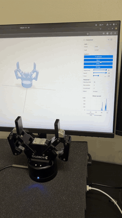
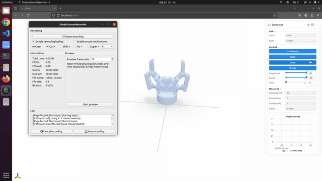

# Robotiq 2F-85 Gripper Python Control & Web UI

Driver, CLI and viser web UI for a Robotiq 2F-85 gripper (CB-Series) over
Modbus RTU on a USB-RS485 adapter.
Modbus RTU is implemented in-tree (pyserial only), so there is no pymodbus
version to keep in step.

<table>
  <tr>
    <th>Real gripper</th>
    <th>Web UI</th>
  </tr>
  <tr>
    <td><a href="assets/real.mp4"></a></td>
    <td><a href="assets/robotiq_viser.mp4"></a></td>
  </tr>
</table>

## Setup on a new machine

```bash
pip install -r requirements.txt
sudo ./setup_permissions.sh          # serial permissions + /dev/robotiq symlink
```

`setup_permissions.sh` needs sudo. It adds you to `dialout` and installs a udev
rule giving the adapter mode 0666 and a stable `/dev/robotiq` name, so the port
cannot drift when other USB serial devices are plugged in. It matches any FTDI
0403:6015 adapter; pass a serial number (`sudo ./setup_permissions.sh DAATR4XA`)
to pin it to one specific cable.

Then plug in the gripper, **give it 24 V**, and:

```bash
./gripper.py status
./gripper.py activate      # calibration sweep, fingers move through full stroke
```

## CLI

```bash
./gripper.py status | activate | reset | stop | monitor
./gripper.py open  [--speed 0-255] [--force 0-255] [--no-wait]
./gripper.py close [--speed 0-255] [--force 0-255] [--no-wait]
./gripper.py move <0-255>   # 0 = open, 255 = closed
./gripper.py mm   <0-85>
```

## Python

```python
from robotiq_2f85 import Robotiq2F85

with Robotiq2F85() as g:
    g.activate()
    g.move_mm(40, speed=120, force=100)
    if g.get_status().object_detected:
        ...
```

`close()` shuts the fingers; the serial port is released by `disconnect()` (or
by leaving the `with` block). Do not confuse the two.

## Web UI

```bash
python3 gripper_web.py            # http://localhost:8080
python3 gripper_web.py --web-port 9000 --port /dev/ttyUSB1
```

The 3D view shows the gripper twice: solid follows the measured position,
translucent blue is the commanded target. A grip that stops early on an object
shows up as a gap between them. The panel has activate/open/close/stop, target
/ speed / force sliders, live readouts and a 20 s motor-current plot.

## Per-unit calibration

`POS_OPEN = 3` and `POS_CLOSED = 230` in `robotiq_2f85.py` are the position
feedback values measured at this gripper's mechanical stops. They affect only
the mm conversion (`mm`, `move_mm`, `opening_mm`), not raw-count commands. On a
different gripper, or after changing fingertips or pads, re-measure:

```python
with Robotiq2F85() as g:
    g.activate()
    print(g.calibrate())    # -> (open, closed) feedback values
```

## Files

| file | role |
|---|---|
| `robotiq_2f85.py` | driver: Modbus RTU, status decoding, motion API |
| `gripper.py` | CLI |
| `gripper_web.py` | viser web UI |
| `robotiq_2f85.urdf` | gripper model, generated |
| `meshes/` | STL geometry referenced by the URDF |
| `make_gripper_urdf.py` | regenerates the URDF from the vendored source model |
| `source_panda_robotiq_85.urdf` | upstream panda+gripper model (from polymetis) |
| `setup_permissions.sh` | serial permissions |

The URDF drives one actuated joint (`robotiq_2f_85_right_driver_joint`,
0 - 0.834 rad); the rest of the linkage mimics it.

Regenerating the URDF (`python3 make_gripper_urdf.py`) is only needed if the
source model changes. It rewrites every mesh reference to the local flat
`meshes/` directory at scale 0.001, because upstream ships `.mtl` material
files without the `.obj` geometry they describe, and the visual scales there
are meant for those missing meshes.

## Troubleshooting

**`gripper did not reply at all`** - total silence on the bus. The USB adapter
answers the host either way, so this means the gripper is not driving the line:
check its 24 V supply first. A supply tripping its current limit on grip stall
current, or an intermittent power connector, produces exactly this, and it
appears only under load - the gripper draws up to ~1 A peak while gripping.

**Link drops when gripping but not when idle** - same cause. Watch the current
plot in the web UI; it dies near the 1 A peak.

**`gripper is not activated`** - run `./gripper.py activate`. Activation is lost
whenever the gripper loses power.
